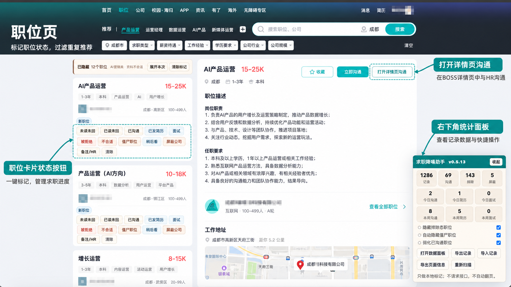
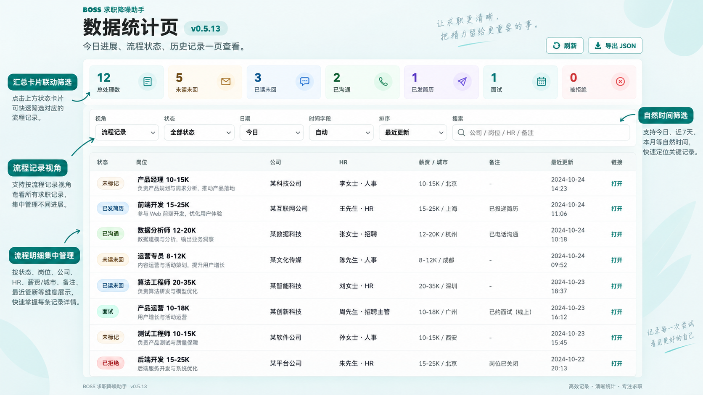
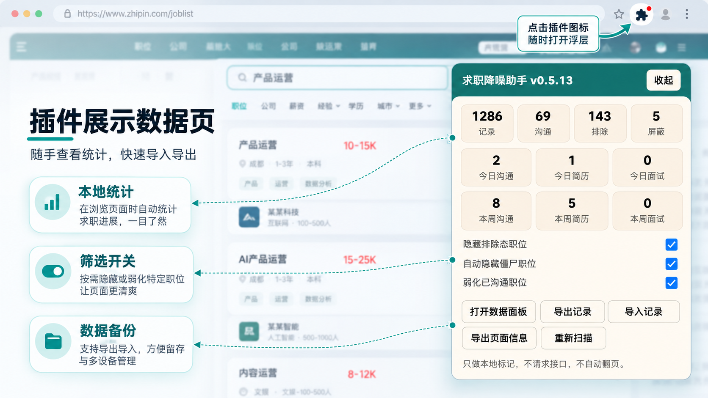

# BOSS 求职降噪助手


一个面向桌面浏览器的本地求职记录插件，用来给 BOSS 直聘职位和消息沟通打上自己的状态标记，减少重复查看、重复沟通和无效推荐干扰。

> 本项目不是 BOSS 直聘官方产品，与 BOSS 直聘无任何隶属或合作关系。插件只读取当前页面已展示内容，只做本地标记，不请求接口、不自动翻页、不自动投递、不自动沟通。

## 它解决什么问题

使用招聘网站时，很多信息会散落在职位列表、职位详情页和消息页里：哪些岗位已经聊过、哪些 HR 已读未回、哪些公司被拒绝过、哪些岗位只是稍后再看。BOSS 求职降噪助手把这些状态保存在浏览器本地，并在你浏览职位或消息时同步展示。

适合这些场景：

- 想区分 `未读未回`、`已读未回`、`已沟通`、`已发简历`、`面试`、`被拒绝` 等流程状态。
- 想隐藏或弱化不合适、被拒绝、低活跃招聘者、已沟通过的职位。
- 想把消息页里的 HR 沟通和职位列表里的岗位记录打通。
- 想用数据面板复盘今天/最近 7 天/最近 30 天的求职动作。
- 想把所有记录留在本机，不上传到任何服务器。

## 功能预览

BOSS 求职降噪助手围绕四个常用工作区展开：消息管理、职位列表、数据统计和右下角插件浮层。

| 页面 | 功能 | 预览 |
| --- | --- | --- |
| 消息管理页 | 在聊天框顶部手动标记沟通状态，左侧消息列表用颜色提示进展，并同步到职位记录。 |  |
| 职位页 | 在职位卡片下方固定展示状态按钮，支持流程标记、排除标记、屏蔽公司和打开详情页沟通。 |  |
| 数据统计页 | 集中查看流程记录、全部职位、排除/暂存记录，支持状态、日期、时间字段和关键词筛选。 |  |
| 插件浮层 | 在页面右下角查看本地统计，快速开关隐藏规则，打开数据面板或导入导出记录。 |  |

## 核心能力

- 职位列表固定状态按钮：`未读未回`、`已读未回`、`已沟通`、`已发简历`、`面试`、`被拒绝`、`不合适`、`僵尸职位`、`稍后看`、`屏蔽公司`、`备注/HR`。
- 消息页右侧聊天框顶部状态工具栏，支持把沟通状态同步到对应职位记录。
- 职位详情页自动补齐 `jobId`、岗位、公司、薪资、城市、HR 等信息。
- 数据面板支持 `流程记录`、`全部职位`、`排除/暂存` 三种视角。
- 支持今日、昨天、最近 7 天、最近 30 天、全部等自然时间筛选。
- 自动识别低活跃招聘者，把低活跃职位标记为 `僵尸职位` 并可自动隐藏。
- 本地导入导出 JSON，便于备份和迁移。
- 多标签页打开时会监听本地记录变化，减少页面间状态不同步。

## 安装

1. 下载或克隆本项目。
2. 打开 `chrome://extensions/` 或 `edge://extensions/`。
3. 开启右上角“开发者模式”。
4. 点击“加载已解压的扩展程序”。
5. 选择项目目录：

```text
boss-job-noise-reducer-extension
```

6. 打开或刷新 BOSS 直聘页面。

如果职位卡片下方出现状态按钮，说明插件注入成功。

## 使用入口

- BOSS 职位列表页：职位卡片下方会出现状态按钮。
- BOSS 消息页：右侧聊天框顶部会出现状态工具栏。
- BOSS 职位详情页：自动补齐职位正式 `jobId`。
- 插件弹窗：点击浏览器插件图标，可打开数据面板。
- 页面右下角浮层：可查看统计、导出记录、导入记录、打开数据面板。

更完整的使用说明见 [docs/USER_GUIDE.md](docs/USER_GUIDE.md)。

产品需求文档见 [PRD-v0.5.13.md](PRD-v0.5.13.md)。

## 数据与隐私

- 所有数据保存在浏览器本地 `chrome.storage.local`。
- 不上传服务器。
- 不请求 BOSS 私有接口。
- 不自动翻页。
- 不自动投递。
- 不自动发送消息。
- 不读取当前页面之外的信息。

本地开发版如果删除扩展后重新加载，可能因为扩展 ID 变化导致旧数据不可见。建议升级前先导出 JSON 备份。

## 项目结构

```text
.
├── manifest.json
├── content.js
├── dashboard.html
├── dashboard.css
├── dashboard.js
├── popup.html
├── CHANGELOG.md
├── CONTRIBUTING.md
├── LICENSE
├── PRD-v0.5.13.md
├── docs/
│   ├── USER_GUIDE.md
│   └── images/
└── README.md
```

## 开发

本项目当前不依赖构建工具，直接加载项目目录即可调试。

基础检查：

```bash
node --check content.js
node --check dashboard.js
```

打包示例：

```bash
cd ..
zip -qr boss-job-noise-reducer-extension.zip boss-job-noise-reducer-extension
```

## 版本说明

当前 `v0.5.15` 重点修复：

- 消息页已标注后，数据面板不再因为临时记录/正式职位记录分裂而显示 `未标记`。
- 面板按 jobKey、公司简称/全称、岗位名规范化规则合并记录。
- 职位页和消息页的状态同步逻辑保持一致，降低 HR 主动联系场景下的数据分裂。
- 默认 `流程记录` 仍只展示明确流程状态，未标记职位保留在 `全部职位`。

更多记录见 [CHANGELOG.md](CHANGELOG.md)。

## 路线图

- 固化回归测试：渲染不空转、跨页面同步、不互相覆盖、详情页不误删。
- 提升消息页职位名识别率。
- 数据面板支持直接编辑状态、备注、HR。
- 增加转化率统计：沟通到简历、简历到面试、面试到结果。
- 支持按公司维度聚合分析。

## 免责声明

本项目仅用于个人本地求职记录管理。请遵守目标网站服务条款和相关法律法规。由用户自行决定是否使用以及如何使用本插件。

## License

MIT License. See [LICENSE](LICENSE).
